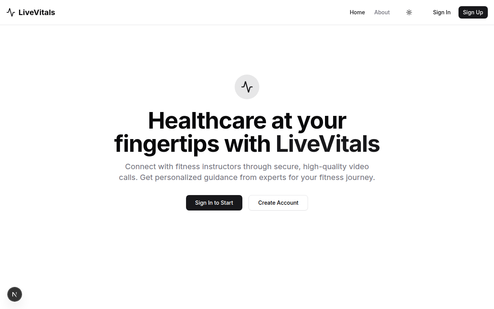
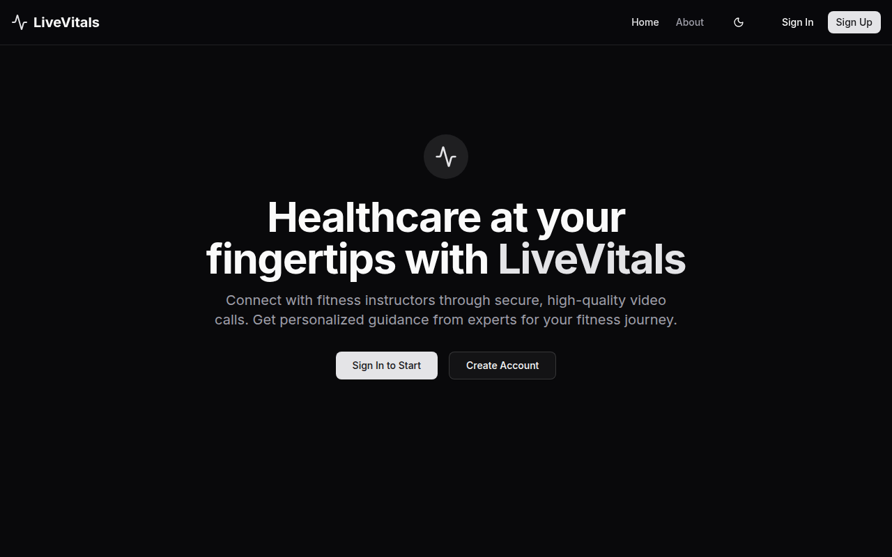
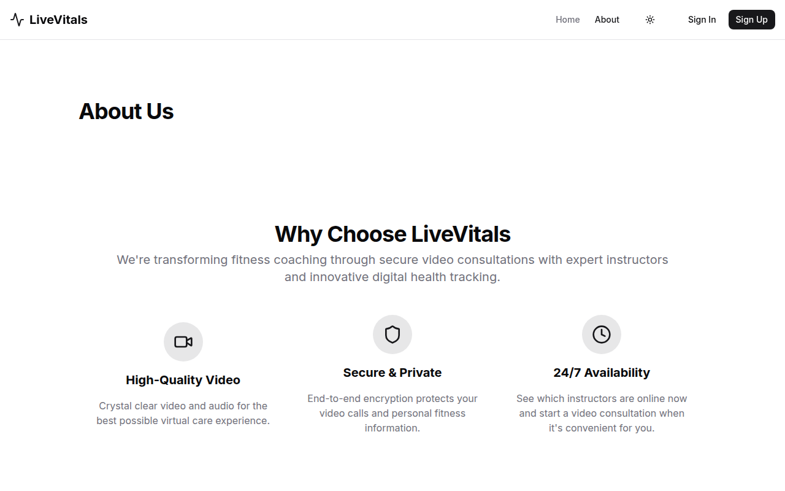
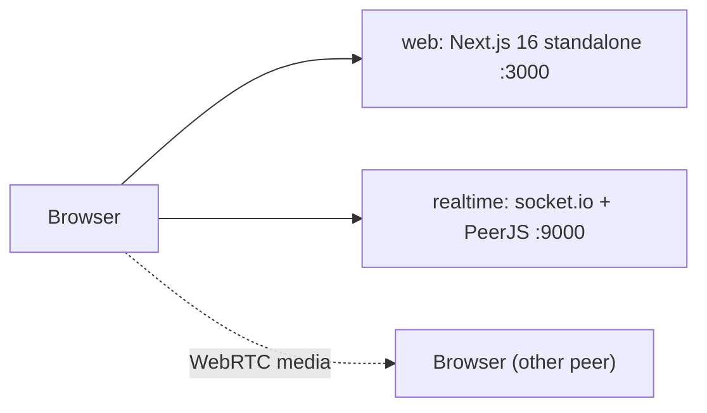

<p align="center">
  
</p>

# LiveVitals

> Connecting gym instructors and their clients, remotely.

[](https://github.com/himanishpuri/livevitals/actions/workflows/ci.yml)
[](https://nextjs.org)
[](https://www.typescriptlang.org)
[](https://ui.shadcn.com)

LiveVitals is a full-stack health and fitness platform for remote personal training. Clients track their health metrics, diet and weekly workout plan, then work with their instructor in real time: text chat, session scheduling, in-app notifications and one-click WebRTC video consultations. A standalone Node service (socket.io + PeerJS) handles presence, message history and WebRTC signalling, so an instructor and a client can hold a full session from anywhere.

## Features

- **Health dashboard** — weight, calorie goal, health metrics and macronutrient charts (Recharts on shadcn charts)
- **Health data input** — log weight, height, calorie intake and notes; persisted locally
- **Diet plans** — browse curated diet plans with a details dialog per plan
- **Weekly workout plan** — 7 day cards with per-exercise detail dialogs
- **Profile & goals** — personal profile, fitness stats and health goals
- **Instructor chat** — real-time 1:1 text chat with typing indicators and message history
- **Video calls** — direct WebRTC video consultations via PeerJS peer IDs
- **Session scheduling** — book sessions with an instructor, persisted on reload
- **Notifications** — in-app notification center with unread badge
- **Dark mode & view transitions** — system-aware theme plus native cross-page transition animations

## Screenshots

| Light | Dark |
| --- | --- |
|  |  |



## Tech stack

| Layer | Tools |
| --- | --- |
| Web app | Next.js 16.4 (App Router, standalone output), React 19.3, TypeScript 6, Tailwind CSS 4.3 |
| UI | shadcn/ui (Radix primitives, new-york style), motion 14, Recharts 3, lucide-react |
| Realtime service | Node, Express, socket.io, PeerJS (`realtime/`, port 9000) |
| Testing | Vitest (16 unit tests), Testing Library, socket.io-client integration tests (10), Playwright (11 E2E tests) |
| Tooling | ESLint (flat config), Docker, docker Compose, GitHub Actions |

## Architecture



Both browsers connect to the realtime service (chat, presence, signalling) and exchange media peer-to-peer over WebRTC.

## Getting started

**Prerequisites:** Node ≥ 24.

```bash
npm ci
npm --prefix realtime ci
cp .env.example .env
```

Run it with two terminals:

```bash
# terminal 1 — realtime service (chat, notifications, video signalling)
npm run dev:realtime

# terminal 2 — web app
npm run dev
```

Web app at http://localhost:3000, realtime service at http://localhost:9000.

## Docker

```bash
docker compose up --build
```

- Web app: http://localhost:3000
- Realtime service: http://localhost:9000

## Testing

```bash
npm test                     # unit tests (Vitest)
npm --prefix realtime test   # realtime integration tests
npm run test:e2e             # Playwright E2E (builds and starts both servers)
```

E2E via Docker:

```bash
docker compose --profile test run --rm e2e
```

## Demo accounts

| Role | Email | Password |
| --- | --- | --- |
| User | `user@example.com` | `password` |
| Instructor | `john@example.com` | `password` |
| Instructor | `sarah@example.com` | `password` |

You can also register a new account (user or instructor); it persists locally.

## Project structure

```
├── docs/screenshots/     # app screenshots
├── e2e/                  # Playwright E2E specs
├── realtime/             # standalone socket.io + PeerJS service
│   ├── src/
│   └── test/
├── scripts/jira/         # project-management tooling
├── src/
│   ├── app/              # App Router pages
│   ├── components/       # feature components + shadcn ui kit
│   ├── context/          # auth, health data, notification providers
│   ├── data/             # mock data (instructors, diet, workout plan)
│   ├── hooks/            # useSocket
│   ├── lib/              # utils, realtime client
│   └── types/
├── compose.yaml
└── Dockerfile
```

## Project management

The project is managed as Scrum in the Jira Cloud project [`LV`](https://thapar-team-mv9022gd.atlassian.net/browse/LV): **9 sprints** (3 history sprints for the original course build, 6 overhaul sprints), **15 epics** and **116 issues**, backed by a committed idempotent REST tooling script in `scripts/jira/`. Every commit and pull request references a `LV-` issue key.

## Team

| Member | Roll number |
| --- | --- |
| Himanish Puri | 102318076 |
| Kush Khandpur | 102318044 |
| Vansh Chauhan | 102318057 |
| Aarushi | 102318078 |
